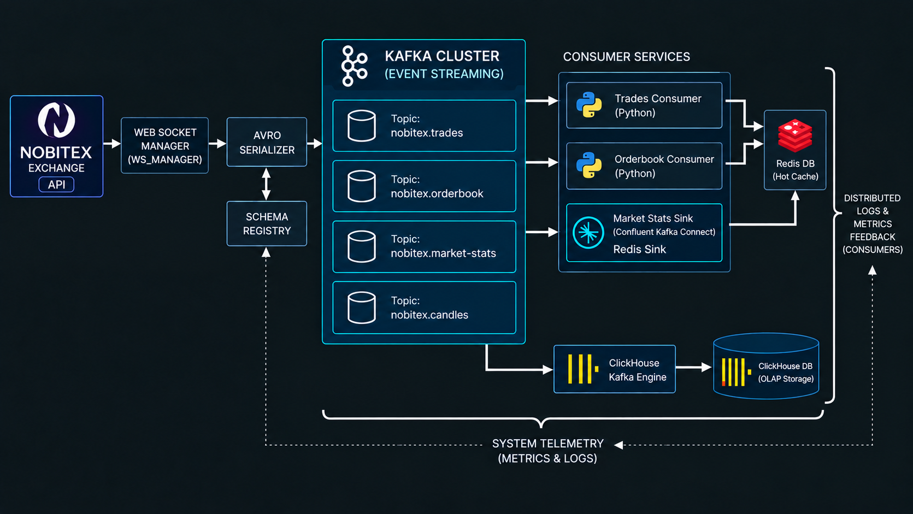
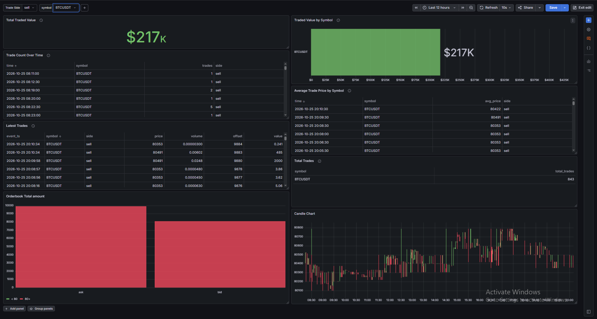
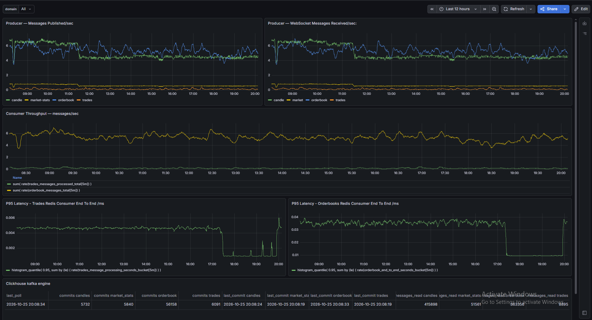

# Market Data Streaming Platform

A real-time crypto market data pipeline. It ingests live order books, trades, candles and market stats from the Nobitex WebSocket API, serialises them as Avro, streams them through Kafka, and stores/serves them via Redis and ClickHouse, with full monitoring (Prometheus, Grafana, Loki).

## Architecture



- Monitoring: Prometheus + Grafana + Loki/Promtail + cAdvisor + node_exporter
- Storage: ClickHouse, Redis

Kafka topics: `nobitex.orderbook`, `nobitex.trades`, `nobitex.candles`, `nobitex.market-stats`.
Avro schemas live in `schemas/`.

## Data Flow

### 1. Producer

The producer is an async Python service that opens four separate WebSocket connections to Nobitex, one for each data type: order book, trades, candles and market stats. Each connection runs independently, so a problem on one stream does not stop the others.

Every incoming message goes through the same steps:

1. **Parse**: the raw WebSocket payload is converted into a clean record.
2. **Serialise**: the record is encoded as Avro using the schemas in `schemas/`, which are registered in the Schema Registry.
3. **Send**: the record is published to its Kafka topic, keyed by symbol so messages for the same symbol stay in order.

The producer waits for all replicas to acknowledge each message and has idempotence enabled to avoid duplicates. If a connection goes silent for too long, it is reconnected automatically. Metrics are exposed on port 9200.

### 2. Consumers

Two groups of consumers read from Kafka:

**Redis consumers** (`consumers/`): these keep the latest state available for fast reads.
- The order book consumer writes each symbol's book to Redis and replaces it in one step, so readers never see a half-updated book.
- The trades consumer appends every trade to a Redis stream, one per symbol plus a global one. Streams are capped (`TRADES_STREAM_MAXLEN`, default 100000) so memory does not grow forever.
- Market stats are written to Redis through a Kafka Connect sink (`connectors/market-stats-redis-sink.json`).

**ClickHouse**: this is the long-term store for analytics. ClickHouse reads the four topics directly using its Kafka table engine, so no extra consumer code is needed. The tables are created by the `migrator` service from the SQL files in `migrations/` when the stack starts.

Both Redis consumers expose Prometheus metrics (messages processed, processing time, end-to-end latency, errors).

## Dashboards

Grafana is provisioned with two dashboards.

### Market Analytics



This dashboard is about the market data itself. It can be filtered by trade side and symbol, and contains:

- **Total Traded Value** and **Traded Value by Symbol**: how much value has been traded in the selected time range.
- **Trade Count Over Time** and **Total Trades**: number of trades per time bucket and in total.
- **Average Trade Price by Symbol**: average price per time bucket.
- **Latest Trades**: the most recent individual trades with time, price, volume and value.
- **Orderbook Total Amount**: total ask amount compared to total bid amount.
- **Candle Chart**: candlestick chart of the price over the selected period.

### Pipeline Health



This dashboard is about the pipeline itself, to check that data is flowing and nothing is falling behind. It has a `domain` filter and contains:

- **Producer: Messages Published/sec**: messages sent to Kafka per second, by data type (candle, market-stats, orderbook, trades).
- **Producer: WebSocket Messages Received/sec**: messages coming in from Nobitex. This should match the published rate; a gap would mean messages are being lost or delayed in the producer.
- **Consumer Throughput**: messages per second processed by the trades and order book consumers.
- **P95 Latency (Trades / Orderbook Redis Consumer)**: 95th percentile processing time of each consumer. The order book panel shows end-to-end time.
- **ClickHouse Kafka Engine**: for each topic, the last poll time, number of commits, last commit time and total messages read. This shows whether ClickHouse is still consuming.

## Prerequisites

- Docker and Docker Compose v2
- ~8 GB free RAM (the stack runs 15 long-running containers plus the one-shot migrator)

## Quick start

```bash
git clone <your-repo-url>
cd marketdata-streaming-platform

# 1. Create your local config and set real values
cp .env.example .env
nano .env            # at minimum, replace every "change_me"

# 2. Start everything
docker compose up -d --build

# 3. Check status / logs
docker compose ps
docker compose logs -f crypto-producer
```

If a required variable is missing, `docker compose` stops immediately and tells you which one.

The ClickHouse migrator runs automatically on every `docker compose up`: it waits until ClickHouse is healthy, creates the tables, and then exits. Running it again is safe. Services also have healthchecks and restart automatically (`docker compose ps` shows their health status).

## Environment variables

All secrets and credentials come from `.env` (never committed). See `.env.example` for the full list.

| Variable | Used by | Notes |
|---|---|---|
| `CLICKHOUSE_DB` / `CLICKHOUSE_USER` / `CLICKHOUSE_PASSWORD` | ClickHouse, migrator | password is **required** |
| `GRAFANA_ADMIN_USER` / `GRAFANA_ADMIN_PASSWORD` | Grafana | password is **required** |
| `REDIS_HOST` / `REDIS_PORT` | consumers | default `redis` / `6379` |

## Service endpoints (default ports)

| Service | URL |
|---|---|
| Kafka UI | http://localhost:8090 |
| Schema Registry | http://localhost:8081 |
| Grafana | http://localhost:3001 |
| Prometheus | http://localhost:9090 |
| Kafka Connect REST | http://localhost:8083 |
| ClickHouse HTTP | http://localhost:8123 |
| Loki | http://localhost:3100 |
| Producer metrics | http://localhost:9200 |

## After Starting the Stack

Once `docker compose up` has finished, open Grafana at http://localhost:3001 and log in with the `GRAFANA_ADMIN_USER` and `GRAFANA_ADMIN_PASSWORD` you set in `.env`. Two dashboards are available:

- **Pipeline Health**: open this first. If data is flowing, the producer panels show messages per second, the consumer panels follow them, and the ClickHouse Kafka engine table shows a recent last poll time.
- **Market Analytics**: shows the actual market data (trades, prices, order book, candles). It fills up as soon as the first messages have been stored, so give it a minute after startup.

You can also check the Kafka side directly in Kafka UI at http://localhost:8090:

- **Topics**: open a topic and go to its **Messages** tab to see the messages arriving live.
- **Consumers**: lists every consumer group with its state and lag, so you can see whether a consumer is keeping up or falling behind.
- **Schema Registry**: shows the registered Avro schemas.

If Pipeline Health shows nothing, check the producer logs with `docker compose logs -f crypto-producer`.

## Kafka Topics

| Topic | Content |
|---|---|
| `nobitex.orderbook` | Order book updates |
| `nobitex.trades` | Executed trades |
| `nobitex.candles` | Candlestick data |
| `nobitex.market-stats` | Market statistics |

Each topic has a single partition. This is enough for the current load, and it keeps message order simple. It also works fine for fan-out: any number of consumer groups can read the same topic independently, so adding a new consumer does not affect the existing ones.

## Configuration

The coins that are streamed are defined in `producers/ws_manager.py`:

```python
COINS = [
    "BTCUSDT", "ETHUSDT", "BNBUSDT", "XRPUSDT",
    "ADAUSDT", "SOLUSDT", "DOGEUSDT", "TRXUSDT", "LTCUSDT"
]
```

To stream another coin, add its symbol to this list, written in the same format as the existing ones (for example `"BTCUSDT"`), and rebuild the producer:

```bash
docker compose up -d --build crypto-producer
```

To stop streaming a coin, remove it from the list and rebuild in the same way. The symbol must be one that Nobitex supports. The candle intervals are defined in the `RESOLUTIONS` list in the same file.

## License

This project is released under the MIT License. See the [LICENSE](LICENSE) file for details.
